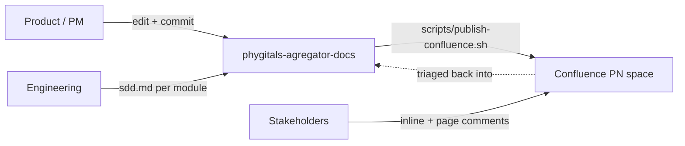

# Phygitals Aggregator - Requirements Docs

Docs-as-code source of truth for the **Phygitals Aggregator** product requirements: one Phygitals partner account shared by many brands, with a Patrianna middleware between the brands and Phygitals and a Payload CMS on top for packs, shipping and operations. Markdown + [Mermaid](https://mermaid.js.org/) live here in git; a local publish helper (`scripts/publish-confluence.sh`) pushes every page to Confluence Cloud so stakeholders can read and comment.

These pages say **what** the product needs and **why**. They do not choose the solution: each module has an `sdd.md` slot that belongs to engineering.

## How this works



- **The repo is canonical.** Confluence pages are read + comment only. The next publish overwrites any edit made in Confluence.
- **Diagrams are text.** Author every diagram as Mermaid inside the Markdown. Do not commit draw.io or binary diagrams.
- **One file = one Confluence page.** The folder layout is mirrored as the page tree through the `Parent` metadata in each file.
- **Every page title contains "Aggregator".** Confluence titles must be unique within a space, and the PN space already holds the Gacha-Lottery pages ("Decision Log", "Modules", "Product Spec - Fulfillment and Shipping", …).

## Repository layout

```
docs/
  overview.md               Product overview: problem, givens, actors, scope (entry page)
  current-state.md          What Collectibles already does with Phygitals (Exists / Partial / New baseline)
  existing-tickets.md       MN Jira tickets for Collectibles, mapped to the modules, and what is not ticketed
  decision-log.md           Open questions and confirmed decisions
  glossary.md               Terms used across the pages
  project-guide.md          How to edit and publish
  modules/<module>/         One folder per capability:
    product-spec.md           What and why (PM)
    user-stories.md           Stories with acceptance criteria (PM)
    sdd.md                    Solution design (engineering)
  _templates/               Page templates (never published)
scripts/                    Local publish helper (publish-confluence.sh)
SETUP-CONFLUENCE.md         One-time Confluence + credentials setup
CODEOWNERS                  Review routing
```

### Modules

| Folder | Module | Story prefix |
| --- | --- | --- |
| `brands-and-onboarding` | Brands and Onboarding | `BRD` |
| `catalog-and-exclusive-cards` | Catalog and Exclusive Cards | `CAT` |
| `purchase-and-reveal` | Purchase and Reveal | `BUY` |
| `collection-and-sell-back` | Collection and Sell-back | `COL` |
| `shipping-and-fulfilment` | Shipping and Fulfilment | `SHP` |
| `funding-and-settlement` | Funding and Settlement | `FND` |
| `back-office-cms` | Back Office (CMS) | `OPS` |
| `brand-integration` | Brand Integration | `INT` |
| `compliance` | Compliance | `CMP` |

## Story conventions

Every story carries two tags:

- **Requirement**: **Validated** (clear and agreed) or **TBC** (waiting on a row in the [Decision Log](docs/decision-log.md)).
- **Baseline**: **Exists**, **Partial** or **New**, measured against the Collectibles service as recorded in [Current State](docs/current-state.md). The baseline tells engineering where the gap is; it does not tell them how to close it.

Story IDs are stable. Never renumber a story; retire it with a note instead.

## Authoring workflow

1. Edit a page under `docs/`, keeping the metadata header (`<!-- Space -->`, `<!-- Parent -->`, `<!-- Title -->`, `<!-- Label -->`) at the very top.
2. Dry-run first: `scripts/publish-confluence.sh` (dry-run is the default).
3. Publish when ready: `scripts/publish-confluence.sh --publish`. See [SETUP-CONFLUENCE.md](SETUP-CONFLUENCE.md) for one-time credential setup.

## Formatting conventions

- **Do not hard-wrap prose.** One paragraph per line; let the editor soft-wrap.
- Use **Mermaid** for flows, sequences and states. Node IDs must not contain spaces; quote labels with special characters.
- Dates are absolute (`2026-10-28`), never "last week".
- `.editorconfig` encodes these defaults.
