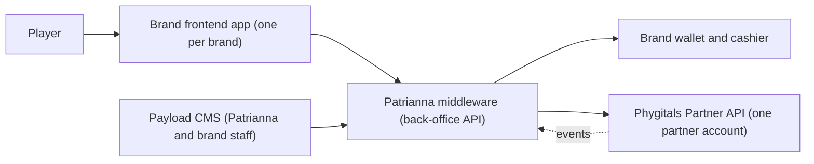

<!-- Space: PN -->
<!-- Parent: Phygitals Aggregator -->
<!-- Title: Phygitals Aggregator - Product Overview -->
<!-- Label: overview -->

> Published from git (source of truth). Do not edit in Confluence — the next publish overwrites this page; comment instead. Source: `docs/overview.md`

# Phygitals Aggregator - Product Overview

**Status:** Draft, 2026-10-28 · **Owner:** Product · **Decisions and open questions:** [Decision Log](decision-log.md) · **What exists today:** [Current State](current-state.md)

## 1. Summary

Patrianna will sell Phygitals' digital packs, each backed by real graded cards, on many brands through **one Phygitals partner account**. Patrianna sits between the brands and Phygitals. It holds the one contract with Phygitals, signs with each brand, funds the one prepaid balance, and gives each brand its own catalog, its own players and its own records. Patrianna also buys extra cards on behalf of particular brands, and only that brand sees those cards.

This page sets out the givens, the goals, who is involved and how the work splits into modules. Each module's Product Spec and User Stories carry the detail. Engineering designs the solution in each module's SDD.

## 2. The givens

Confirmed by product on 2026-10-28. Every requirement in these pages must be compatible with them.

| # | Given | What it means for the requirements |
| --- | --- | --- |
| G1 | There is **one Phygitals partner account and API** for every brand. | Phygitals has no idea what a brand is. Everything brand-specific — catalog, players, records, money per brand — is Patrianna's to provide. |
| G2 | **Patrianna holds the Phygitals contract** and handles the contract with each brand. | Brands never deal with Phygitals. Every cost must be traceable to the brand that caused it, so Patrianna can settle with that brand. |
| G3 | **Patrianna buys extra cards in the name of each brand.** | Some stock belongs to one brand. It must be tracked as that brand's from purchase to sale, sell-back or shipment. |
| G4 | **A brand's specific cards are seen only by that brand.** | Visibility is per brand down to the card, not only to the pack. No other brand's player may see or pull them. |
| G5 | **A Patrianna backend is the middleware** between the brands and Phygitals. | Brands never call Phygitals and never hold its credentials. |
| G6 | **A Payload CMS sits on top of the middleware** to manage packs, shipping and operations. The back-office API serves both the CMS and each brand's frontend app. | Operators work in the CMS, not in code or in Phygitals' dashboard. Brand apps and the CMS see the same data. |
| G7 | **Patrianna's own brands launch first; third-party partner brands follow.** | Launch scope can be internal brands, but nothing may assume a brand is internal: separation, settlement and access must hold for an external partner. |
| G8 | **Requirements state the need; engineering defines the solution.** | These pages describe outcomes and constraints, not tables, endpoints or services. |

## 3. Problem and goals

**Problem.** Today the Collectibles service connects each brand to Phygitals as if each brand had its own partner account. Every brand sees the whole Phygitals catalog under Phygitals' names and prices. There is no back office, no per-brand catalog, no brand-exclusive stock, no view of what each brand consumed from a shared balance, and no state rules on shipping. See [Current State](current-state.md).

**Goals.**

1. A new brand goes live by configuration and a commercial agreement with Patrianna, not by a new Phygitals contract or a code change.
2. Each brand sells its own selection of packs under its own presentation.
3. A brand's exclusive cards are never seen or pulled by another brand's players.
4. Patrianna knows at any time what each brand has consumed from the shared balance, and can settle with every brand from its own records.
5. Shipping charges and delivery times meet state rules, and every card's fair market value (FMV) is fixed at the rip.
6. Operations run packs, shipping and player support from the CMS without engineering.

**Non-goals (draft, to confirm).** Changing Phygitals' draw, odds, vault or fulfilment; a marketplace where players trade with each other; replacing a brand's own cashier, KYC or responsible-gaming tools.

## 4. Who is involved

| Actor | Who | What they need |
| --- | --- | --- |
| **Player** | A registered user of one brand | Buy and open packs, see their cards, sell them back, get them shipped, at a clear price, within the legal limits of their state |
| **Brand** | One of Patrianna's own brands, later a partner operator | Its own catalog, prices and presentation; its own players and data, never mixed with another brand's; reports on what it sold and consumed |
| **Brand integrator** | The team building a brand's frontend app | A stable way to offer every player flow without touching Phygitals |
| **Patrianna super-admin** | Product / commercial | Onboard brands, decide which packs and exclusive cards each brand gets |
| **Patrianna operations** | Shipping and support staff | Work shipping orders and exceptions, answer player questions, pause what needs pausing |
| **Patrianna finance** | Finance | Keep the prepaid balance funded, see each brand's consumption, settle with brands, reconcile against Phygitals |
| **Compliance / legal** | Legal | State rules on shipping fees and deadlines, FMV at rip, player eligibility, and proof that they are followed |
| **Phygitals** | Supplier | One partner, one prepaid balance, one set of credentials |

## 5. Context

The givens, drawn. How the middleware is built inside is engineering's to decide.

## 6. Modules

| Module | Scope |
| --- | --- |
| [Brands and Onboarding](modules/brands-and-onboarding/product-spec.md) | Adding a brand, what it is set up with, keeping brands apart, own brands now and partners later |
| [Catalog and Exclusive Cards](modules/catalog-and-exclusive-cards/product-spec.md) | Which packs and cards each brand sells and shows, and cards bought for one brand only |
| [Purchase and Reveal](modules/purchase-and-reveal/product-spec.md) | Buying a pack, opening it, the value fixed at that moment |
| [Collection and Sell-back](modules/collection-and-sell-back/product-spec.md) | Cards held in the vault, selling them back, cards nobody acts on |
| [Shipping and Fulfilment](modules/shipping-and-fulfilment/product-spec.md) | Requesting a shipment, its cost, its deadline, exceptions |
| [Funding and Settlement](modules/funding-and-settlement/product-spec.md) | The shared prepaid balance, each brand's consumption, settling with brands |
| [Back Office (CMS)](modules/back-office-cms/product-spec.md) | What staff do in the CMS |
| [Brand Integration](modules/brand-integration/product-spec.md) | What a brand's app can do and the guarantees it gets |
| [Compliance](modules/compliance/product-spec.md) | Shipping rules by state, FMV at rip, eligibility, records |

## 7. Compliance inputs

Received 2026-10-28 from the legal review of the officer's certificate. They become requirements in [Compliance](modules/compliance/product-spec.md) and [Shipping and Fulfilment](modules/shipping-and-fulfilment/product-spec.md); how to read them in our flows is open in the [Decision Log](decision-log.md).

1. **Shipping fees are reasonable and based on what shipping costs the Company.** The Company has certified this.
2. **Every claimed card ships within the required timeframes.** The Company has certified this.
3. **Some states limit shipping charges and regulate shipping time.** Example, Virginia: once a participant is notified that they won a prize, the sponsor must deliver it within **10 days**, with **no obligation or expense to the winner**. A handling fee may not exceed the actual cost of handling and is capped at **USD 5.00**.
4. **FMV is determined at the moment of the Rip** and cannot be altered after a Card Pack is ripped.

## 8. Reference material

- [Current State](current-state.md): what the Collectibles service does with Phygitals today. Every story's Baseline tag is measured against it.
- Phygitals Partner API **1.17.0**: `Collectibles/docs/phygitals-api-reference.json`. The copy in the `api` repo is **1.0.0** and out of date.
- [Multi-Brand Pack Aggregator](https://claude.ai/artifact/3zLvSBVD4FWCzcvPCme66x): a solution sketch, offered to engineering as input. It is not a requirement. It was written against API 1.0.0; the 1.17.0 spec adds a prepaid balance read, partner-owned packs, shipping cancellation, transfers between users and two more events, which changes several limits the sketch lists.
